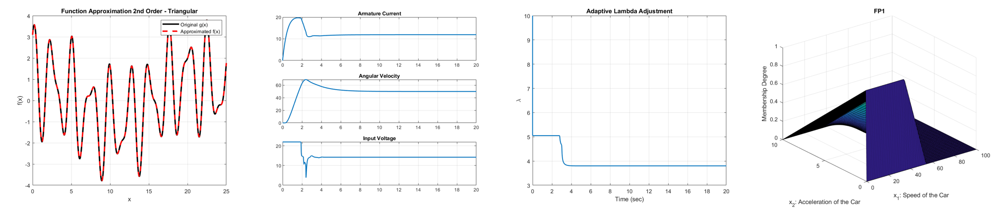

<h1 align="center">Fuzzy-Control-Projects</h1>

<p align="center">
  My two projects from the graduate Fuzzy Control course: fuzzy approximation of a nonlinear function, and fuzzy speed control of a DC motor with saturation, dead zone and friction.
  <br>
  MSc in Electrical Engineering (Control) at
  <a href="https://www.iust.ac.ir/">Iran University of Science and Technology</a>, Autumn 1403 (2024).
</p>

<p align="center">
  
  
  
  
</p>

<p align="center">
  
</p>

<p align="center"><sub>
  Left to right: second-order fuzzy approximation of g(x) (Project 1), the motor under fuzzy-tuned PID and the adaptive sliding slope λ of the fuzzy SMC (Project 2), and the premise surface of the class exercise.
  All re-generated by running the code in this repository.
</sub></p>

---

## Projects

| Project | What it does | Highlights |
|---|---|---|
| [**1. Function approximation**](Project1-Function-Approximation/) | Approximates g(x) = 2cos(2.5x) + sin(4x) + 1.1cos(0.3x) on [0, 25] to ε = 0.02 | First/second-order accuracy designs (triangular and Gaussian), lookup table, gradient-descent training and clustering; the triangular designs meet ε, the data-driven ones use 50-300 rules but don't reach ε |
| [**2. DC motor speed control**](Project2-DC-Motor-Speed-Control/) | Tracks 50 rad/s on a motor with saturation, a 2 V dead zone, Coulomb friction and load | PID vs. single-input fuzzy vs. fuzzy-tuned PID vs. sliding-mode control with a fuzzy slope; the fuzzy SMC settles in 3.3 s with no overshoot |

Each project folder has the MATLAB scripts, an **English summary in LaTeX** (`report_en.pdf`, source next to it, shared [`tex/preamble.tex`](tex/preamble.tex)), `figures/` re-generated by running the scripts, and a short README. A small [class exercise](Class-Exercise-Mamdani-Car-Pedal/) on fuzzy implication operators is included too.

The fuzzy systems (membership functions, rule bases, inference, defuzzification) are written by hand; the Fuzzy Logic Toolbox is not used. The project statements and slides belong to the course and are not included; each README describes the task in my own words.

## How to run

**MATLAB** (base, no toolboxes; tested on R2023b). Run any script from its folder, or run everything and save all figures:

```matlab
addpath tools
run_all        % runs every script, writes <folder>/figures/*.png and *.txt
step_metrics   % rise time, overshoot, settling time for Project 2
```

## License

[MIT](LICENSE).
